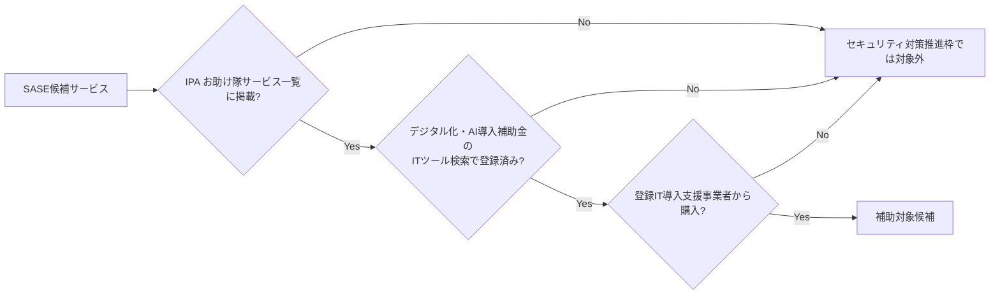
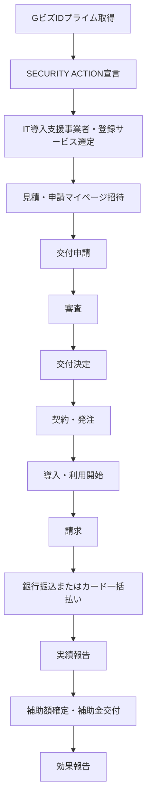

# デジタル化・AI導入補助金2026「セキュリティ対策推進枠」Deep Research

**推奨ファイル名:** `docs/digital-ai-2026-security-frame.md`  
**調査基準日:** 2026年11月15日（Asia/Tokyo）  
**推奨ブランチ:** `research/digital-ai-2026-security-frame`  
**コミットメッセージ案:** `docs: add deep research on 2026 security subsidy framework`

## Executive Summary

2026年11月15日時点の結論として、デジタル化・AI導入補助金2026の「セキュリティ対策推進枠」は、一般的なSASE・ZTNA・SWG・CASB・SD-WAN導入費を広く補助する制度ではありません。補助対象になるためには、**IPAの「サイバーセキュリティお助け隊サービスリスト」に掲載され、さらにデジタル化・AI導入補助金側でIT導入支援事業者がカテゴリー10のITツールとして事前登録しているサービス**であることが必要です。したがって、製品名が「SASE」「ZTNA」等であるだけでは補助対象になりません。 citeturn279639view3turn822752search0

補助額は**5万円以上150万円以下**、補助率は**中小企業1/2以内、小規模事業者2/3以内**です。補助対象経費は「サービス利用料（最大2年分）」であり、ITツール登録要領上、カテゴリー10ではサービスの**初期費用と月額費用を登録**し、交付申請時に利用台数・ライセンス数と1年または2年の利用年数を申請します。このため、SASE導入時の初期設定等が登録済みサービスの「初期費用」に組み込まれているケースは対象になり得ますが、登録外の独立した設計、SI、ネットワーク構築、コンサルティング等を別費目で加えることは、この枠では原則期待できません。 citeturn589351view0turn822752search5

2026年10月9日から適用された**第7回公募以降の公募要領**が現時点で重要です。第7次締切は**2026年12月1日17:00**、交付決定予定は**2027年1月19日**、事業実績報告期限は**2027年7月30日17:00**です。また事務局は2026年10月30日に、デジタル化・AI導入補助金2026全体の最終交付申請期限を**2027年1月7日17:00**と告知していますが、2026年11月15日時点のスケジュールページではセキュリティ対策推進枠の「8次締切分」の詳細日程がまだ明示展開されていません。したがって、現時点で確実に日程が確定している申請機会としては12月1日の第7次締切を基準に準備するのが安全です。 citeturn786804view0turn371562search5

申請には**GビズIDプライム**と**SECURITY ACTIONの一つ星または二つ星**が必要です。注意すべき点は、二つ星はセキュリティ対策推進枠の必須要件ではなく、現行公募要領では**一つ星でも申請可能で、二つ星は加点項目**です。GビズIDプライム取得には公式案内上おおむね2週間を要するため、未取得企業は申請準備の最優先事項です。 citeturn589351view0turn613831view5turn228733view4

さらに第7回公募以降、IT導入補助金2022～2025で交付決定を受けた事業者には、一定の例外を除き、1人当たり給与支給総額を**1年後3.5%以上向上、3年間の年平均成長率3.5%以上向上**させる計画・従業員への表明が申請要件として追加されています。未達の場合には補助金全部の返還を求められる場合があるため、過年度採択企業はセキュリティ製品選定より先にこの条件を確認すべきです。 citeturn279639view0

**一次情報:**  
`https://it-shien.smrj.go.jp/pdf/it2026_kaitei_koubo_security.pdf`  
`https://it-shien.smrj.go.jp/applicant/subsidy/security/`  
`https://www.ipa.go.jp/security/sme/otasuketai/servicelist/index.html`  
**確認日時:** 2026-11-15 JST

## 制度の仕組みと申請対象

制度趣旨は、中小企業・小規模事業者等がセキュリティ対策ITツールを導入する費用の一部を補助し、サイバーインシデントによる事業停止・生産性低下や、供給制約等の潜在的リスクを低減することです。制度は申請企業単独でIT製品を購入して後から請求する仕組みではなく、**申請者と登録IT導入支援事業者が共同で申請を進める構造**になっています。 citeturn589351view0

対象となる中小企業の基準は業種ごとに異なり、例えば製造業・建設業・運輸業は「資本金3億円以下または常時使用する従業員300人以下」、卸売業は「1億円以下または100人以下」、小売業は「5,000万円以下または50人以下」等です。小規模事業者は商業・サービス業が原則5人以下、宿泊・娯楽業と製造業その他が20人以下です。 citeturn589351view0

| 項目 | 2026年11月15日時点 |
|---|---|
| 補助額 | 5万円～150万円 |
| 中小企業 | 補助率1/2以内 |
| 小規模事業者 | 補助率2/3以内 |
| 対象期間 | サービス利用料 最大2年分 |
| 主対象 | IPAお助け隊リスト掲載＋ITツール登録済みサービス |
| 第7次締切 | 2026年12月1日 17:00 |
| 第7次交付決定予定 | 2027年1月19日 |
| 第7次事業実施・実績報告期限 | 2027年7月30日 17:00 |
| 全体最終申請期限の公式告知 | 2027年1月7日 17:00 |
| 申請回数 | セキュリティ対策推進枠では原則1法人・1個人事業主につき1回 |

根拠は第7回公募以降の公募要領および事業スケジュールです。 citeturn589351view0turn786804view0turn371562search5  
**一次情報URL:** `https://it-shien.smrj.go.jp/pdf/it2026_kaitei_koubo_security.pdf`、`https://it-shien.smrj.go.jp/schedule/`  
**確認日時:** 2026-11-15 JST

申請に先立って必要なのは、GビズIDプライム、SECURITY ACTION宣言、登録IT導入支援事業者とITツールの選定です。SECURITY ACTIONは公募要領上**★一つ星または★★二つ星**で申請要件を満たし、★★二つ星は加点になります。 citeturn589351view0turn572804view0

また申請企業全体の労働生産性について、基準年度から3年間で**年平均成長率1%以上**の向上を目標とする事業計画を策定する必要があります。労働生産性は本制度では「（営業利益＋人件費＋減価償却費）÷年間の事業者当たり総労働時間」と定義されています。 citeturn279639view0

## SASE・ZTNA・SWG・CASB・SD-WANの補助対象性

この枠をSASE導入に利用する際の最重要ルールは、製品カテゴリーではなく**登録状態**です。公募要領2-2は、補助対象ITツールを「IPAのお助け隊サービスリスト掲載サービスのうち、IT導入支援事業者が提供し、事務局に事前登録されたサービス」と限定しています。 citeturn279639view3

IPAのお助け隊サービス登録一覧は2026年10月20日の第14回審査結果を反映して15サービスが追加されており、提供事業者一覧も2026年10月30日に更新されています。したがって、過去に対象だったサービスでも削除・登録取消しの可能性があるため、**申請直前にIPA側と補助金側の二重確認が必要**です。 citeturn228654search4turn228654search5

| SASE関連費目 | セキュリティ対策推進枠での判断 |
|---|---|
| SASEクラウド利用料 | **条件付き対象**。お助け隊掲載＋カテゴリー10登録済み部分のみ |
| ZTNAライセンス | **条件付き対象**。上記サービスの登録価格・ライセンスに含まれる場合 |
| SWG利用料 | **条件付き対象**。登録済みお助け隊サービスに含まれる場合 |
| CASB利用料 | **条件付き対象**。登録済みサービスに組み込まれている場合 |
| SD-WAN利用料 | **原則、名称だけでは判断不可**。セキュリティお助け隊サービスとして登録された範囲のみ |
| 初期設定費 | **条件付き対象**。カテゴリー10で登録されている「初期費用」に含まれる場合 |
| 月額利用料 | 対象。登録価格の範囲内、最大2年分 |
| 24か月ライセンス | 対象になり得る。ITツール登録要領は1年または2年での申請を想定 |
| 独立したSI・設計費 | **原則対象外と考えるべき**。カテゴリー10で独立した導入関連費区分は設けられていない |
| 独立したコンサル費 | 同上 |
| SASE用ルータ等の単体購入 | **原則対象外**。本枠の対象経費は「サービス利用料」 |
| 既存SASE契約の交付決定前費用 | 対象外 |
| 登録外ベンダーからの直接購入 | 対象外 |

この判断は、公募要領がセキュリティ枠の補助対象を「サービス利用料（最大2年分）」とし、ITツール登録要領がカテゴリー10について**初期費用・月額費用を登録し、申請時に利用台数／ライセンス数と1年または2年の利用年数を申請する**構造にしていることに基づきます。独立した設計・SI費等の対象外判断は、この制度構造からの実務的解釈であり、個別サービスについては登録されたITツールの価格内訳を事務局・IT導入支援事業者に確認する必要があります。 citeturn822752search5turn279639view3

なおIPA登録一覧ページを2026年11月15日に「SASE」「ZTNA」「SWG」「CASB」「SD-WAN」で確認した範囲では、それらの語そのものは登録一覧ページ本文にはヒットしませんでした。ただし、これは該当機能を持つサービスが存在しないことを意味しません。サービス名称や説明がSASE用語を使っていない場合があるため、**サービス単位で機能仕様を確認する必要があります**。 citeturn409070view0turn409070view1turn409070view2turn409070view3turn409070view4

登録確認は次の二段階で行います。



IPA登録一覧は `https://www.ipa.go.jp/security/sme/otasuketai/servicelist/index.html`、補助金側は公式サイトの「ITツール検索」から確認します。登録されていないITツールは交付申請できません。 citeturn822752search0turn228733view3  
**確認日時:** 2026-11-15 JST

## 申請・契約・支払いの実務

申請手順は、IT導入支援事業者への相談、ITツール選定・見積、支援事業者からの申請マイページ招待、申請者によるマイページ開設、共同での交付申請作成、申請者による提出、審査・交付決定、契約・導入・支払い、実績報告、補助額確定・入金、効果報告という順序です。 citeturn403719view0



**交付決定前の契約・発注は禁止**です。公募要領は、ITツールの契約・発注を交付決定後に行うよう明記しており、契約・発注が導入・支払いよりも先でなければなりません。また支払い前にはIT導入支援事業者から請求が行われている必要があります。順序違反は補助金不交付や交付決定取消しにつながる可能性があります。 citeturn403719view1

支払方法は原則、**銀行振込またはクレジットカード1回払い**です。現金払い、分割払い、リボ払いは不可です。法人は法人名義口座からの銀行振込、または法人名義口座から決済される法人・ビジネス・コーポレートカードを使用します。口座振替は、支払事実を通帳等で確認できる場合に認められます。 citeturn279639view2turn403719view1

交付申請時の主な必要書類は次のとおりです。法人は、発行3か月以内の履歴事項全部証明書、直近の法人税納税証明書「その1」または「その2」、直近の貸借対照表・損益計算書です。個人事業主は本人確認書類、所得税納税証明書、確定申告書控え、青色申告決算書または収支内訳書が必要です。代替書類は原則認められません。 citeturn403719view0

実績報告では、請求書・請求明細、振込証憑またはカード利用明細、補助金受取口座情報、契約書・利用申込書等が必要です。契約資料から**契約日が交付決定後であること、補助事業者とIT導入支援事業者の契約であること、利用者・利用期間**が確認できなければなりません。 citeturn403719view2

**一次情報URL:** `https://it-shien.smrj.go.jp/pdf/it2026_kaitei_koubo_security.pdf`  
**確認日時:** 2026-11-15 JST

## 審査・採択・効果報告・他補助金との併用

審査は事務局による申請内容審査の後、学識有識者を含む専門家からなる外部審査委員会の意見を踏まえて採択を決定します。主な審査観点は、自社の経営課題の理解、内部プロセス高度化・データ活用、生産性向上、既存のセキュリティ対策、IT投資・活用状況、サプライチェーンへの寄与、労働生産性向上率などです。 citeturn572804view0

主な加点項目には、SECURITY ACTION二つ星、賃上げ計画、IT戦略ナビwith、健康経営優良法人2026、えるぼし・くるみん等、成長加速マッチングサービス、省力化ナビ活用、最低賃金関連要件等があります。一方、過去のIT導入補助金採択や、過去に加点を受けた賃上げ目標の未達等は減点対象となる場合があります。 citeturn572804view0turn572804view1

補助金交付後も義務は終了しません。効果報告では営業利益、人件費、減価償却費、総労働時間、1人当たり給与支給総額、事業場内最低賃金、セキュリティ対策状況等を報告します。第7回以降の公募要領では、1年度目の効果報告期間を2028年4月～2029年1月、3年度目を2030年4月～2031年1月としており、2年度目の報告は不要とされています。ITツールを継続利用している証憑や、必要に応じ決算書等の提出も求められます。 citeturn403719view2

補助期間中・効果報告前にサービスを解約・利用停止すると辞退扱いとなり、全部または一部返還となる可能性があります。特に必須賃上げ要件の対象事業者は、判定前に辞退すると未達扱いとなり、**全額返還**となる旨が明記されています。 citeturn403719view2turn279639view0

他補助金との併用については、国、中小機構その他独立行政法人の補助金と**同一事業・同一経費を重複させることは不可**です。一方、2026年の他枠へ同時申請すること自体は可能ですが、同じ費用を二重計上すると交付決定取消し・全額返還の対象になり得ます。 citeturn589351view0turn572804view0

これは例えば、SASEライセンスを本枠に計上し、まったく同じSASEライセンスを東京都の助成金にも計上する、といった使い方は避けるべきことを意味します。異なる経費を制度ごとに明確に切り分けられる場合の併用可否は、各制度側の募集要項も併せて確認する必要があります。 citeturn589351view0

## 金額別試算と対象外時の代替制度

補助額の基本計算は次のとおりです。

```text
中小企業：
補助額 = min（補助対象経費 × 1/2, 150万円）

小規模事業者：
補助額 = min（補助対象経費 × 2/3, 150万円）

ただし補助額の下限は5万円
```

補助率と上限は公募要領に基づきます。 citeturn279639view3

| 補助対象経費 | 中小企業 1/2 | 中小企業自己負担 | 小規模 2/3 | 小規模自己負担 |
|---:|---:|---:|---:|---:|
| 50万円 | 25万円 | 25万円 | 約33.3万円 | 約16.7万円 |
| 200万円 | 100万円 | 100万円 | 約133.3万円 | 約66.7万円 |
| 1,000万円 | **150万円（上限）** | 850万円 | **150万円（上限）** | 850万円 |

したがって、**SASE案件が1,000万円規模になると、本枠単独では補助効果がかなり小さくなります**。150万円上限に達する補助対象経費は、中小企業なら300万円、小規模事業者なら225万円です。これは制度上限からの算術計算です。 citeturn279639view3

SASEが「お助け隊サービス＋ITツール登録」という条件を満たさない場合、東京都内の事業者には**東京都中小企業振興公社「サイバーセキュリティ対策促進助成金」**が有力な代替候補です。2026年度制度では、UTM、FW、VPN、不正侵入検知、EDR/EPP、SSO・本人認証、アクセスログ管理、暗号化、クラウド利用等が対象とされ、助成率1/2、上限500万円、下限10万円です。第3回は2027年1月8日～15日受付予定です。 citeturn681066search0turn681066search6

SASEのうちZTNA・アクセス制御・認証・FW・VPN等を構成する費用については、東京都制度の方が国のセキュリティ対策推進枠より**対象経費の概念が広い可能性があります**。ただしSASEという名称だけで採択されるわけではなく、「主たる目的がサイバーセキュリティ向上」であること、募集要項の費目に適合することが必要です。 citeturn681066search0

もう一つの選択肢はデジタル化・AI導入補助金2026の**通常枠**です。通常枠ではカテゴリー4「セキュリティ」として、カテゴリー1ソフトウェアを安全に利用するための暗号化、ウイルス防御、アクセス制限等を登録できます。ただしカテゴリー4は主たるソフトウェアに付随する位置付けであり、SASE単独導入の万能な代替枠ではありません。 citeturn822752search0

**代替制度一次情報:**  
`https://www.tokyo-kosha.or.jp/support/josei/setsubijosei/cyber.html`  
`https://it-shien.smrj.go.jp/itvendor/procedure/ittool/`  
**確認日時:** 2026-11-15 JST

## 実務チェックリストと申請上の落とし穴

SASE導入を前提とした実務フローは次の順番が安全です。

1. **自社資格を確認する。** 中小企業・小規模事業者区分、大企業支配要件、過去3年の課税所得等を確認し、IT導入補助金2022～2025の採択歴がある場合は第7回以降の賃上げ必須要件を先に確認します。 citeturn589351view0turn279639view0  
2. **GビズIDプライムを取得する。** 発行目安はおおむね2週間です。締切直前では間に合わないリスクがあります。 citeturn228733view4  
3. **SECURITY ACTIONを宣言する。** 最低要件は一つ星または二つ星ですが、可能であれば二つ星を取得すると加点になります。 citeturn589351view0turn572804view0  
4. **IPAリストを確認する。** 「SASEだから対象」ではなく、提供予定サービスが最新のお助け隊登録一覧に存在するか確認します。 citeturn228733view3  
5. **ITツール検索を確認する。** IPA掲載だけでは不足で、補助金事務局側でカテゴリー10として登録済みである必要があります。 citeturn822752search0  
6. **登録価格の内訳を確認する。** 月額、初期費用、ライセンス数、利用年数、UTM等の構成をIT導入支援事業者から書面で確認します。登録外のSI費を混ぜないことが重要です。 citeturn822752search5  
7. **交付申請を提出する。** 契約はまだしません。 citeturn403719view1  
8. **交付決定を待つ。** 交付決定後に初めて契約・発注します。 citeturn403719view1  
9. **導入・利用開始・請求・支払を期限内に完了する。** 請求より先の支払いを避け、銀行振込またはカード一括払いを使用します。 citeturn403719view1  
10. **証憑を保存し実績報告する。** 契約書、請求書、支払証憑、利用期間が分かる資料を保存します。 citeturn403719view2  
11. **効果報告までサービスを維持する。** 安易な途中解約は補助金返還リスクがあります。 citeturn403719view2

最も危険な落とし穴は、**交付決定前の契約、IPA掲載だけを見てITツール登録確認を忘れる、SASE一式見積の中に対象外SI費を混在させる、現金・分割・リボ払い、請求前の支払い、他補助金への同一経費の二重計上、過年度採択企業が賃上げ義務を見落とすこと**です。これらはいずれも不交付、取消し、返還につながり得るため、見積・契約書を「登録ITツール費」と「対象外費用」に分離しておくことが実務上重要です。 citeturn403719view1turn572804view0turn279639view0

### 未確認・今後確認が必要な事項

2026年11月15日時点では、公式スケジュールページにセキュリティ対策推進枠の「8次締切分」という見出しは存在しますが、その詳細日程はページ本文に表示されていません。一方、事務局は制度全体の最終期限を2027年1月7日17:00と発表しています。そのため、**セキュリティ対策推進枠の第8次について交付決定日・事業実施期限等は現時点で未確認**です。 citeturn786804view0turn371562search5

また、特定のSASE製品、例えば特定ベンダーのSASE/SSE製品がカテゴリー10として登録されているかどうかは、製品名・ITツール番号を個別にITツール検索で照合しない限り断定できません。IPA一覧本文にSASE、ZTNA、SWG、CASB、SD-WANという一般名称がないことも、対象外を意味しません。 citeturn409070view0turn409070view1turn409070view2turn409070view3turn409070view4

### GitHub格納用メタデータ

```yaml
file: docs/digital-ai-2026-security-frame.md
branch: research/digital-ai-2026-security-frame
commit_message: "docs: add deep research on 2026 security subsidy framework"
review_date: 2026-11-15
next_review:
  - 2026-12-02
  - when_8th_round_schedule_is_published
  - before_contracting_any_SASE_service
primary_sources:
  - https://it-shien.smrj.go.jp/pdf/it2026_kaitei_koubo_security.pdf
  - https://it-shien.smrj.go.jp/schedule/
  - https://it-shien.smrj.go.jp/applicant/subsidy/security/
  - https://it-shien.smrj.go.jp/itvendor/procedure/ittool/
  - https://www.ipa.go.jp/security/sme/otasuketai/servicelist/index.html
  - https://www.tokyo-kosha.or.jp/support/josei/setsubijosei/cyber.html
```

上記URLはいずれも本調査で確認した公式一次情報です。デジタル化・AI導入補助金側の公募要領は**2026年10月9日版・第7回公募以降**を基準にしています。 citeturn589351view0turn272851search0