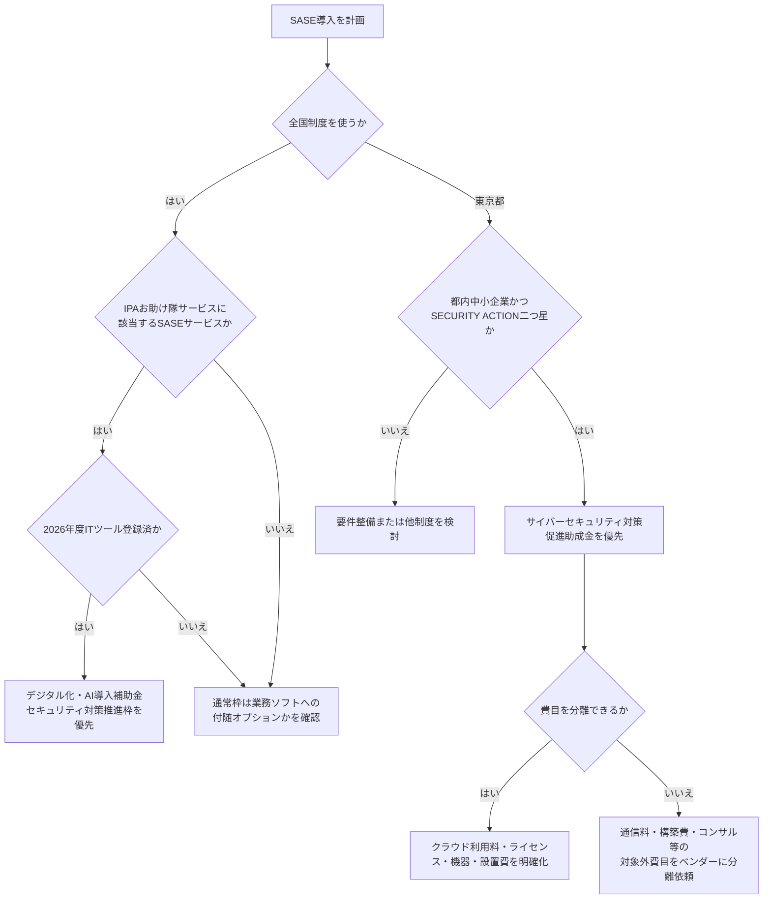

# 日本国内でSASE導入に利用し得る補助金・助成金調査報告書

## Executive Summary

2026年11月15日時点で、企業がSASE（Secure Access Service Edge：ZTNA、SWG、CASB、SD-WAN等）を導入する際に、**全国制度で最も適合可能性が高いのは「デジタル化・AI導入補助金2026 セキュリティ対策推進枠」**です。旧「IT導入補助金」は2026年度から「デジタル化・AI導入補助金」に名称変更され、セキュリティ対策推進枠は、IPAの「サイバーセキュリティお助け隊サービスリスト」掲載サービスのうち、IT導入支援事業者が提供し、かつ事務局にITツール登録されたサービスの利用料を最大2年分補助します。2026年の第7次締切は**2026年12月1日17:00**で、補助率は中小企業1/2、小規模事業者2/3、補助額5万～150万円です。 citeturn543118search0turn647159view1turn938155search6

SASEそのものも対象になり得ることは一次情報で確認できます。IPAは「お助け隊サービス」2類について、クラウドサービスを対象とした異常監視機能の例として「CASB、SASEなど」を明示しており、2026年11月10日現在の登録サービスには、監視製品として**Check Point Harmony SASE-Internet Access**を用いるサービスも掲載されています。したがって、「SASEだから不可」ではありません。ただし、**任意のSASE製品を買えば補助されるわけではなく、対象サービスがIPAのお助け隊サービスリストに載り、さらに当該年度のITツールとして登録されていること**が必要です。 citeturn916064search0turn916064search1turn916064search3turn647159view1

東京都内の中小企業については、**「サイバーセキュリティ対策促進助成金」もSASEとの親和性が非常に高い**制度です。VPN、FW、アクセス管理、ログ管理、EDR/EPP等に加え、「同内容のサービス利用」も対象で、物品購入、ライセンス料、設置費、クラウドサービスの初期費用・利用料まで対象になり得ます。助成率1/2、上限500万円で、第3回募集は**2027年1月8日9:00～1月15日17:00予定**です。クラウド利用料は最長12か月、物品に含まれるライセンス料は保守・運用・サポート費を含み最長5年と募集要項に明記されています。一方、別建ての「設計費、改修費、開発費、構築費」は対象外です。 citeturn497198view1turn900771view0turn210633view0turn210633view2

東京都の「中小企業デジタル導入促進補助事業」は2026年11月現在募集中ですが、**SASE用途には原則として優先順位が低い**と判断します。募集要項が「OS、セキュリティソフト」「社内の通信環境・テレワーク環境の整備・増強」を対象外例として明示しているためです。2026年度第2回は**2026年9月28日～2027年1月29日**、助成率1/2（小規模企業者等は2/3）、上限150万円です。 citeturn239115view0turn419613view0turn918750view0

また、東京都の「DX推進トータルサポート助成金」は、機器・システム構築・ソフトウェア・クラウド利用費を広く対象にし、最大5,000万円の枠もありますが、**アドバイザーによる事前支援と提案書が必須**です。2026年度第1回は申請期間が2026年11月2日～11月30日であるものの、必須の事前予約は11月6日に終了しているため、**11月15日時点で新規に着手して今回申請することはできません**。既に予約済みの企業で、SASEがDX・生産性向上計画の一部として提案書に位置付けられている場合に限り有力です。 citeturn967026search3

## 制度比較

以下は、SASE導入との実務上の関係が比較的強い制度に絞った比較です。補助・助成対象の最終判断は、製品名ではなく、登録状況・契約形態・導入目的・費目区分によって行われます。 citeturn647159view1turn210633view0turn419613view0

| 制度名 | 主管 | 対象地域 | 2026/11/15時点の公募状況・締切 | 補助率・上限 | 主な申請要件 | SASE適合性 |
|---|---|---|---|---|---|---|
| **デジタル化・AI導入補助金2026 セキュリティ対策推進枠** | 経済産業省・中小企業庁／事務局 | 全国 | 申請受付中。第7次締切 **2026/12/1 17:00**、交付決定予定2027/1/19。 citeturn938155search6 | 中小企業1/2、小規模2/3。5万～150万円。 citeturn647159view1 | 中小企業・小規模事業者等。対象は「お助け隊サービス」掲載＋ITツール登録済サービス。 citeturn647159view1turn647159view2 | **◎ 最有力**。SASEを用いるお助け隊登録サービスが実在。ただし登録サービス単位で判断。 citeturn916064search3 |
| **デジタル化・AI導入補助金2026 通常枠** | 経済産業省・中小企業庁／事務局 | 全国 | 第7次締切 **2026/12/1 17:00**。 citeturn647159view0turn938155search6 | 原則1/2、一部2/3。5万～150万円未満、4プロセス以上は～450万円。 citeturn647159view0 | 1種類以上の業務プロセスを持つソフトウェアが必須。セキュリティは「オプション」。 citeturn647159view0 | **△**。SASE単体申請は難しく、業務ソフトの導入に付随する登録済セキュリティオプションとしての位置付けが基本。 |
| **東京都 サイバーセキュリティ対策促進助成金** | 東京都・東京都中小企業振興公社 | 東京都中心 | 第2回終了。第3回 **2027/1/8 9:00～1/15 17:00予定**。 citeturn497198view1turn900771view0 | 1/2、上限500万円、下限10万円。 citeturn900771view0 | SECURITY ACTION二つ星、都内で実質1年以上事業、中小企業等。 citeturn900771view0 | **◎ 非常に有力**。FW/VPN、アクセス管理、ログ管理、クラウド型同等サービス等を明示。 citeturn210633view0 |
| **東京都 中小企業デジタル導入促進補助事業** | 東京都・東京都中小企業振興公社 | 東京都 | 第2回 **2026/9/28～2027/1/29**、予算到達で早期終了あり。 citeturn239115view0turn419613view0 | 1/2、小規模企業等2/3。上限150万円。 citeturn239115view0 | 都内中小企業・個人事業主等。新規導入の一般販売パッケージ／クラウド。 citeturn419613view0 | **×～△**。セキュリティソフト、通信・テレワーク環境整備は明示的な対象外例。 citeturn918750view0 |
| **東京都 DX推進トータルサポート助成金** | 東京都・東京都中小企業振興公社 | 東京都 | 申請 **2026/11/2～11/30**。ただし必須の事前予約は**11/6終了**。 citeturn967026search3 | 生産性向上1/2～4/5等。上限1,500万～5,000万円（コース・賃上げ要件による）。 citeturn967026search3 | DX推進トータルサポート事業の支援を受け、アドバイザー提案書に基づくこと。 citeturn967026search3 | **○ 条件付き**。SASEがDX・生産性向上の基盤として提案書に明確に組み込まれていれば有力。 |

公式情報は、国の制度が[デジタル化・AI導入補助金2026公式サイト](https://it-shien.smrj.go.jp/)および[中小企業庁](https://www.chusho.meti.go.jp/)、東京都制度が[東京都中小企業振興公社](https://www.tokyo-kosha.or.jp/)および[デジタル化推進ポータル](https://iot-robot.jp/)です。 citeturn543118search0turn593334search0turn967026search3

### SASE費目別の適否比較

「◎」は制度上かなり明確、「○」は条件付きで適合、「△」は契約・登録内容次第、「×」は原則対象外、「未確認」は一次資料で十分に確認できなかったものを示します。

| 制度 | 初期構築・導入設定 | 機器 | ソフト／ライセンス | クラウド月額 | 運用・保守 |
|---|---|---:|---:|---:|---:|
| 国：セキュリティ対策推進枠 | **○** お助け隊サービスの「導入費用」として登録価格内なら対象可能 | **△** サービス構成に含まれる場合。単独購入を目的とする制度ではない | **◎** 登録済お助け隊サービスとして | **◎ 最大2年分** | **◎/○** お助け隊サービス利用料に含まれる監視・初動対応等は対象となり得る citeturn647159view1turn543118search7 |
| 国：通常枠 | **○** 導入設定等は役務対象 | **×～△** 通常枠の基本対象に一般ハードを含めない | **△** 必須の業務ソフトに付随するセキュリティオプションなら可能 | **○ 最大2年分** | **○** 保守サポートは役務対象。ただしSASE単独では要件不足になりやすい citeturn647159view0 |
| 東京：サイバーセキュリティ対策促進助成金 | **△** 機器の設置費は対象。ただし「構築費」は対象外 | **◎** FW/VPN/UTM等 | **◎** ライセンス料は対象、保守・運用・サポートを含み最大5年 | **◎** 初期費用＋利用料、最長12か月 | **○** ライセンス料に含む保守・運用・サポートは対象。ただし独立した業務委託・構築費等は対象外 citeturn210633view0turn210633view2 |
| 東京：中小企業デジタル導入促進補助 | **○** 初期設定等は関連経費 | **△** 専用機器のみ一部可、一般ハード不可 | **×～△** 「セキュリティソフト」は対象外例 | **△** 一般クラウドは対象だが、SASEはセキュリティ／通信環境整備の対象外規定に抵触しやすい | **○** 対象ツールに付随する管理・保守・運用サービス費は対象になり得る citeturn239115view0turn419613view0turn918750view0 |
| 東京：DX推進トータルサポート助成金 | **○** システム構築費が対象 | **○** 機器導入費あり | **○** ソフトウェア導入費 | **○** クラウド利用費 | **未確認** 詳細費目はコース別要項で確認が必要。SASEを単なるセキュリティ更新ではなくDX計画に結び付ける必要あり citeturn967026search3 |

## 制度ごとの詳細分析

### 全国：デジタル化・AI導入補助金2026 セキュリティ対策推進枠

この制度は2026年度の旧IT導入補助金の後継制度の一部です。中小企業庁は2026年3月10日付で、令和7年度補正予算事業から名称を「デジタル化・AI導入補助金（旧：IT導入補助金）」に変更したと明示しています。 citeturn543118search0turn543118search3

対象となるのは、IPAの「サイバーセキュリティお助け隊サービスリスト」に掲載され、かつIT導入支援事業者が提供し、事務局へITツール登録されたサービスです。単なる製品型番の購入ではなく、監視・相談・初動対応等を含むサービスとして補助対象になる点が重要です。 citeturn647159view1turn916064search6

SASEとの関係では、IPAのお助け隊2類の要件に、クラウド異常監視の例として「CASB、SASEなど」が明示されています。さらに、公式登録サービスの一例として、株式会社アクトの「Webセキュリティ Plus」は、監視製品としてCheck Point Harmony SASE-Internet Accessを採用し、全国対象となっています。したがって、SASEを補助対象にする現実的なルートがすでに存在します。 citeturn916064search0turn916064search3

対象経費は「ITツールの導入費用およびサービス（最大2年分）」で、経済産業省の案内でも「お助け隊サービスにかかる初期費用や導入費用を2年間分」、中小企業1/2、小規模2/3、最大150万円と整理されています。 citeturn647159view1turn543118search7

申請前発注は不可です。公式手続ページは、**「交付決定前に発注・契約・支払い等を行った場合は、補助金の交付を受けることができません」**と明記しています。 citeturn938155search0

SASEで申請する場合は、見積書に「SASEライセンス」だけを書くのではなく、**補助対象となる登録ITツール名・ITツール番号、利用期間、初期費、月額または年額、監視・SOC・初動対応等の内訳**をIT導入支援事業者と揃えることが実務上重要です。登録されていないSASE製品や、登録サービスとは別契約のSD-WAN回線・通信料等まで自動的に対象になるわけではありません。これは対象が「登録されたサービス」に限定されていることから導かれる判断です。 citeturn647159view1turn916064search6

### 東京都：サイバーセキュリティ対策促進助成金

東京都の制度は、SASEを構成する機能と助成対象経費の対応がかなり明瞭です。募集要項は、UTM、FW、VPN、不正侵入検知、EDR/EPP、SSO・本人認証、アクセスログ管理等を例示し、さらに「上記製品群と同内容のサービスの利用」を対象にしています。SASEのSWG、ZTNA、CASB、FWaaS等を、これらの機能との対応関係で説明できれば適格性を主張しやすい構造です。 citeturn210633view0

費目面でも有利です。2026年度第2回募集要項では、物品購入費について「ライセンス料（保守・運用・サポート費）も助成の対象」とし、5年間を限度としています。クラウドサービスについては、サブスクリプションの初期費用と利用料を対象とし、対象利用料は最長12か月です。 citeturn210633view0turn382018view0

一方、注意点はかなり明確です。機器の搬入・設置費は対象になりますが、「設計費、改修費、開発費、構築費」は対象外です。したがって、ベンダー見積の「SASE構築費」「ポリシー設計費」「要件定義費」「移行コンサルティング費」は、そのままでは助成対象外となる可能性が高い一方、機器の物理設置や、対象ライセンスに内包された保守・運用・サポートは対象になり得ます。 citeturn210633view2turn382018view1

また、2026年度要項は、セキュリティ向上を伴わない単なる更新を対象外としています。既存VPNをSASEに入れ替える場合も、「期限切れだから更新」では弱く、ZTNA化、CASBによるクラウド制御、SWGによるWeb制御、拠点・在宅を統合したポリシー適用、ログ可視化等、**更新前と比較した具体的なセキュリティ向上**を申請書・構成図・対照表で示す必要があります。 citeturn900771view0

申請前にSECURITY ACTION二つ星宣言が必要で、都内で実質1年以上事業を行っていること等も要件です。都内に本店があれば、一定条件の下で東京近県の事業所への設置も認められます。 citeturn900771view0turn210633view0

採択前発注も不可です。要項は、対象期間内に発注・契約・実施・支払いを行う必要があるとし、交付決定日前に発注・契約・設置した機器は対象外と明記しています。 citeturn900771view0turn210633view2

### 東京都：中小企業デジタル導入促進補助事業

本制度は2026年11月15日時点で公募中で、申請期間は2026年9月28日～2027年1月29日です。助成対象期間は交付決定翌月から2年間、上限150万円、原則助成率1/2、小規模企業者等は2/3です。ツール本体に加えて初期設定、カスタマイズ、管理・保守・運用サービス費も対象になり得ます。 citeturn239115view0turn419613view0

しかし、SASE目的では不適合リスクが高い制度です。2026年度第2回募集要項の申請対象者確認フローチャートでは、対象外例として**「OS、セキュリティソフト」**、**「社内の通信環境・テレワーク環境の整備・増強」**を明記しています。SASEはセキュリティと通信基盤を統合するため、申請内容がここに該当すると判断される可能性があります。 citeturn419613view0turn918750view0

そのため、本制度でSASEを狙うより、東京都のサイバーセキュリティ対策促進助成金を優先する方が合理的です。もしSASEがセキュリティではなく特定業務プロセスのデジタル化に組み込まれた特殊なサービスである場合でも、公社が個別製品・ベンダーを事前認定しているわけではないため、申請前に対象外規定との整合を確認すべきです。 citeturn239115view0turn918750view0

### 東京都：DX推進トータルサポート助成金

DX推進トータルサポート助成金は、機器・ロボット導入費、システム構築費、ソフトウェア導入費、クラウド利用費、データ分析費を対象とし、SASEを単なるセキュリティ製品としてではなく、DX推進・生産性向上の基盤投資として位置付けられる企業には有力です。 citeturn967026search3

ただし、申請の前提として東京都中小企業振興公社の「DX推進トータルサポート事業」のアドバイザー支援を受け、アドバイザー作成の提案書を受領し、その内容に基づいて申請する必要があります。提案書作成には最低3か月程度を要すると公式ページが案内しています。 citeturn967026search3

2026年度第1回については事前予約期間が2026年10月15日～11月6日、申請期間が11月2日～11月30日です。そのため、2026年11月15日時点で既に予約をしていない企業は、この回には新規参入できません。 citeturn967026search3

## SASE導入時の適格性判断と申請戦略

SASEでは、「製品名」よりも**何を買い、どの契約で、どの機能を、何のために使うか**が補助対象判断を左右します。特にSASEは、SWG・CASB・ZTNA・FWaaS・SD-WAN・SOC・ログ管理・ID連携など複数の要素を束ねるため、一つの見積に「対象」と「対象外」が混在しやすい点に注意が必要です。東京都制度では通信料・プロバイダ料金が対象外とされており、SASEのクラウドセキュリティ利用料と、インターネット回線・SD-WAN回線費は分離して見積を取得するのが安全です。 citeturn210633view0

実務上の判断フローは次のとおりです。

全国制度を狙う場合の第一チェックは、導入候補サービスがIPAの[サイバーセキュリティお助け隊サービス一覧](https://www.ipa.go.jp/security/otasuketai-pr/)にあるか、さらに[デジタル化・AI導入補助金のITツール検索](https://it-shien.smrj.go.jp/)で2026年度登録されているかです。両方を満たさなければ、セキュリティ対策推進枠の対象にはなりません。 citeturn647159view1turn916064search2

東京都制度の場合は、SASE見積を少なくとも「クラウド利用料」「ライセンス」「機器」「設置費」「構築・設計」「通信回線」「運用・サポート」に分けるべきです。2026年度サイバーセキュリティ対策促進助成金では、クラウド初期費・利用料、一定のライセンス料、設置費は対象になり得ますが、構築費・開発費・通信費・コンサル費は対象外です。 citeturn210633view0turn210633view2

さらに、既存VPNやUTMの単純更新ではなく、「従来VPNからZTNAへの移行」「クラウド利用可視化・CASB導入」「拠点・在宅・外出先で同一セキュリティポリシーを適用」「ログ統合と異常検知」「IDベースの最小権限アクセス」など、**導入前後のセキュリティ向上を定量・定性的に示すこと**が東京都制度では重要です。更新前後の差分説明が求められているためです。 citeturn900771view0

## 申請実務上の注意事項と一次資料引用

最重要の注意点は、いずれの主要制度でも**交付決定前に発注・契約を進めないこと**です。国のデジタル化・AI導入補助金では、公式サイトが次のように明記しています。

> 「交付決定前に発注・契約・支払い等を行った場合は、補助金の交付を受けることができません。」

出典：デジタル化・AI導入補助金2026「交付決定後に必要な手続き」。 citeturn938155search0

東京都のサイバーセキュリティ対策促進助成金でも、2026年度募集要項は、対象期間について「発注・契約・実施（購入）・支払（決済）を上記期間内に行う必要があります」と規定し、対象外経費として交付決定日前に導入された設備を掲げています。 citeturn900771view0turn210633view2

SASEのクラウド費用について、東京都の2026年度募集要項には次の重要な規定があります。

> 「クラウドサービスの初期費用および利用料を助成対象期間内に一括で支払う費用が対象」

さらに、対象利用料は「最長：12カ月」とされています。出典：令和8年度サイバーセキュリティ対策促進助成金募集要項「7 助成対象経費（4）クラウドサービス利用料等」。 citeturn210633view0turn382018view0

同制度では、物品購入費に関連するライセンスについても、

> 「ライセンス料（保守・運用・サポート費）も助成の対象とします。ただし、5年間を限度とする。」

とされています。これにより、SASEの契約形態が「クラウド利用料」なのか「機器購入＋期間ライセンス」なのかで対象期間の考え方が異なる点に注意が必要です。 citeturn210633view0turn382018view0

一方、同じ要項には対象外経費として「設計費、改修費、開発費、構築費」が明記されています。SASEベンダーの見積に「初期構築一式」としか書かれていない場合、対象経費と対象外経費を判別できず、減額または対象外となるリスクがあるため、見積段階で費目を分けるのが望ましいです。 citeturn210633view2turn382018view1

東京都のデジタル導入促進補助事業については、募集要項の対象外例が明確です。

> 「OS、セキュリティソフト、表計算・文書作成ソフト等、汎用性の高いソフト」

および「社内の通信環境・テレワーク環境の整備・増強」が対象外例に挙げられています。したがって、SASE導入をこの制度で申請する場合は、事前相談なしに適格と断定すべきではありません。 citeturn419613view0turn918750view0

## 結論

2026年11月15日時点で、SASE導入補助を検討する場合の優先順位は、**全国の中小企業なら「デジタル化・AI導入補助金2026 セキュリティ対策推進枠」**、**東京都内の中小企業なら「東京都サイバーセキュリティ対策促進助成金」**が第一候補です。前者は対象サービスが「IPAお助け隊＋ITツール登録」の二重条件を満たす必要がありますが、実際にSASE製品を組み込んだお助け隊登録サービスが存在します。後者は製品登録制ではなく、機能・導入目的・経費区分で判断されるため、ZTNA、SWG、CASB、FWaaS、VPN代替などをセキュリティ向上策として構成しやすく、上限も500万円と大きいのが特徴です。 citeturn647159view1turn916064search3turn210633view0

東京都のサイバーセキュリティ対策促進助成金については、2026年11月15日時点で第2回募集は終了済みですが、第3回が**2027年1月8日～1月15日**に予定されているため、これから申請準備を始める余地があります。SECURITY ACTION二つ星宣言、GビズID、比較見積、現状／導入後ネットワーク構成図、セキュリティ向上の対照表、SASE見積の費目分解を先に進めることが実務上重要です。 citeturn497198view1turn900771view0

全国制度は第7次締切が**2026年12月1日17:00**であるため、既にIT導入支援事業者と商談中で、対象SASEサービスのITツール登録が確認できる企業は、こちらを先に検討する価値があります。ただし、国・東京都その他の補助金で**同一経費を二重に受給することはできない**ため、同じSASEライセンスや初期費用を重複計上しないよう制度選択を行う必要があります。東京都の募集要項も、同一経費について他の公的助成との重複交付を認めない旨を明記しています。 citeturn938155search6turn900771view0